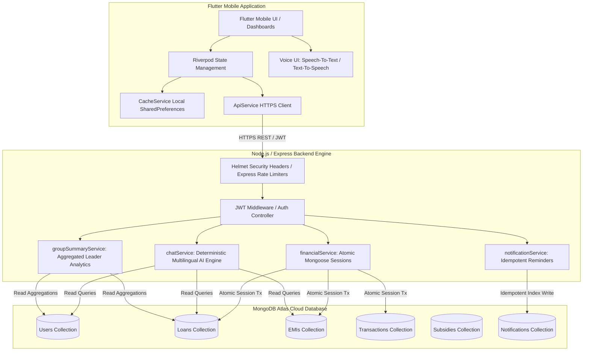
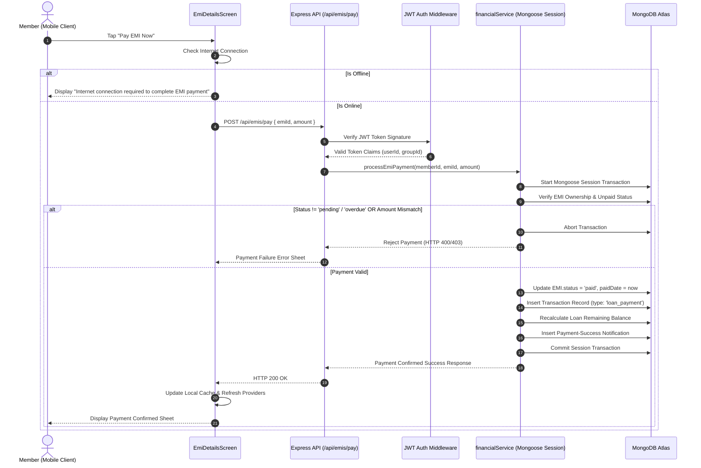
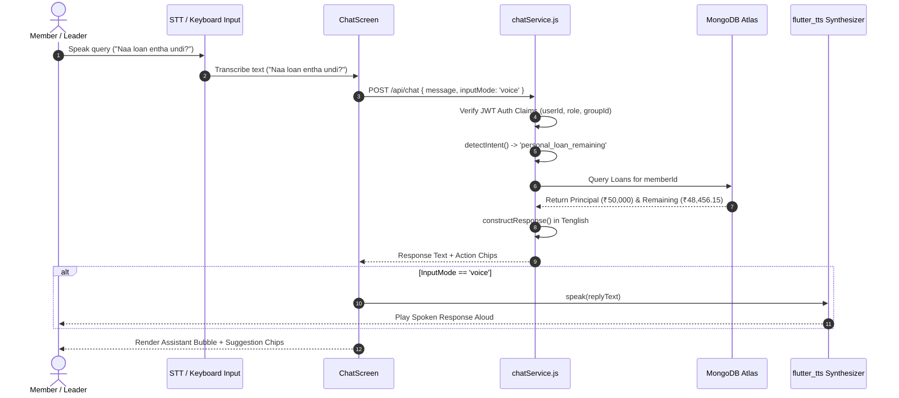

# DWCRA CONNECT TECHNICAL ARCHITECTURE SPECIFICATION

---

## 1. HIGH-LEVEL SYSTEM ARCHITECTURE

DWCRA Connect is designed as a multi-tier microfinance platform comprising a **Flutter Mobile Application**, a **Node.js/Express REST API Service**, and a **MongoDB Atlas Document Database**.

---

## 2. COMPONENT DATA FLOWS

### 2.1 Atomic EMI Payment Sequence

---

### 2.2 Multilingual Voice & AI Assistant Flow

---

## 3. SECURITY & CACHE DESIGN

### 3.1 Rate Limiting Topology
- **Auth Limiter**: Applied to `/api/auth/` $\rightarrow$ Max 20 requests per 15 minutes per IP.
- **Sensitive Action Limiter**: Applied to `/api/emis/pay` & `/api/chat` $\rightarrow$ Max 60 requests per 15 minutes per IP.
- **General API Limiter**: Applied to `/api/` $\rightarrow$ Max 300 requests per 15 minutes per IP.

### 3.2 User-Scoped Local Cache Key Structure
- Account Summary: `cache_${userId}_account_summary`
- Loans List: `cache_${userId}_loans_${memberId}`
- EMI Schedule: `cache_${userId}_emis_${memberId}`
- Transaction Statement: `cache_${userId}_txs_${memberId}`
- Notification List: `cache_${userId}_notifications`
- Group Summary (Leaders Only): `cache_${userId}_group_members_summary_${groupId}`
